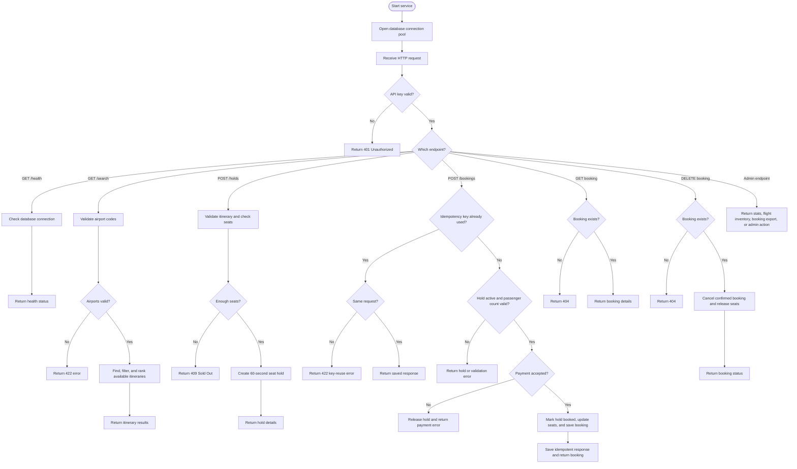

# Flight Booking System

Airline reservation backend for COMP 4340/6340 Project 2, built to the
Flight Control contract.

- URL: `http://localhost:8080`
- API key: `dev-key`


## Start the airline

Requires Docker Desktop. From the repository's top folder, enter the project
directory first:

```
cd COMP40340-6340_Flight-Booking-System
docker compose up --build
```

In a separate terminal, check that it is running:

```
curl -H "Authorization: Bearer (DEV KEY HERE)" http://localhost:8080/health
```

Bookings are kept in a Docker volume and survive restarts. To wipe all
data as well, run `docker compose down -v`.

## Optional UI experience

To run the UI, in a separate Terminal:

```
cd COMP40340-6340_Flight-Booking-System
uv run python -m app.gradio_ui
```

You will be given a URL to run in your browser. This URL should be http://127.0.0.1:7860

To check the status of your booking, run this in a separate terminal:
```
curl -H 'Authorization: Bearer (DEV KEY HERE)' \
  http://localhost:8080/bookings/(BOOKING ID HERE)
```

## For Enoch Levandovsky

Running the tests should be the same as the parent program:

```
cd COMP40340-6340_Flight-Booking-System
uv run flightcontrol test --url http://localhost:8080 --key dev-key --test N
```

Replace N with a value between 1-5 to run the coresponding tests

| Test | What happens | Must hold (otherwise the test scores 0) | Score from 0 to 1 |
|---|---|---|---|
| 1 Steady | 1 traveler per second, always on while you are connected | nothing, it is for watching | not scored |
| 2 Rush | travelers per second step up 5, 10, 20, 30, 40, 30 seconds each step | no oversell, no partial itinerary | highest step where 95% of travelers are correct and the p95 of each correct traveler's server time, added up over its calls, is under 500 ms. Divided by 40 |
| 3 Last seat | 10 rounds. A flight is filled to within 1 to 3 seats, then 40 travelers try to book it at once | exactly the remaining seats sold, every loser gets `409` | rounds passed divided by 10 |
| 4 Restart | 5 travelers per second for 3 minutes, restart called at 60 seconds | every confirmed booking still there, new `boot_id`, healthy within 60 seconds | fraction of travelers correct after you come back |
| 5 Audit | 10 travelers per second for 3 minutes with duplicate requests, cancellations, declined payments and abandoned holds, then a 70 second drain | no answer breaks a rule, at least 95% of travelers correct, at least 100 bookings made, and stats, per-flight seats and the booking export all match Flight Control's record exactly | 1 if everything holds |

## Application flow



## Stop the airline

```
cd COMP40340-6340_Flight-Booking-System
docker compose down
```